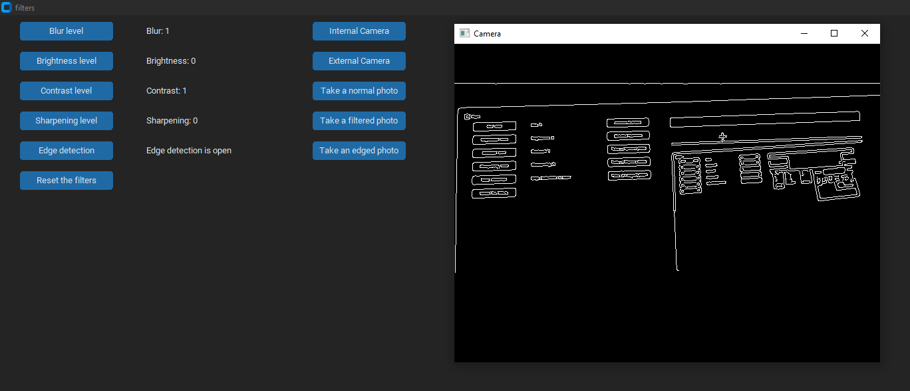

# Camera Filters

A Python application that uses OpenCV and CustomTkinter to apply real-time camera filters and capture photos.

## Features

- **Blur:** Adjust the blur level of the camera feed.
- **Brightness:** Increase or decrease image brightness.
- **Contrast:** Adjust the contrast of the image.
- **Sharpening:** Enhance image details.
- **Edge Detection:** Detect edges in the camera feed.
- **Photo Capture:** Save normal, filtered, and edge-detected images.
- **Camera Selection:** Switch between internal and external cameras.

## Screenshot



## Technologies Used

- Python
- OpenCV (`opencv-python`)
- CustomTkinter
- NumPy

## Installation

### 1. Clone the repository

```bash
git clone https://github.com/ByFabz/git-basic-cam-filters.git
cd git-basic-cam-filters
```

### 2. Install the dependencies

Make sure Python is installed, then run:

```bash
python -m pip install -r requirements.txt
```

## Usage

Run the application using:

```bash
python main.py
```

Make sure your camera is connected and accessible. Use the interface to adjust filters, switch between cameras, and save images.

## Notes

-Press Q while the camera window is active to close it. You can also close the application by clicking the X button on the camera window or the UI.
-A thread-related error may appear in the terminal a few seconds after closing the camera window.

## Project Structure

- `main.py` — Application entry point.
- `camera.py` — Camera capture and processing loop.
- `tkUI.py` — User interface.
- `state.py` — Shared application state.
- `button_commands.py` — Filter settings and input dialogs.
- `photo_functions.py` — Photo capture and saving functions.
- `EdgeDetection_and_extras.py` — Edge detection and additional camera functions.

## Requirements

- Python 3.13.2 (version used for testing).
- Windows (tested platform).
- A working camera.
- The dependencies listed in `requirements.txt`.

**Note:** Compatibility with macOS has not been verified.

## License

This project is licensed under the MIT License. See the [LICENSE](LICENSE) file for details.
